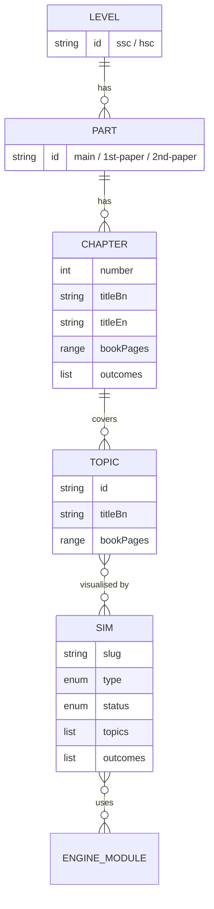
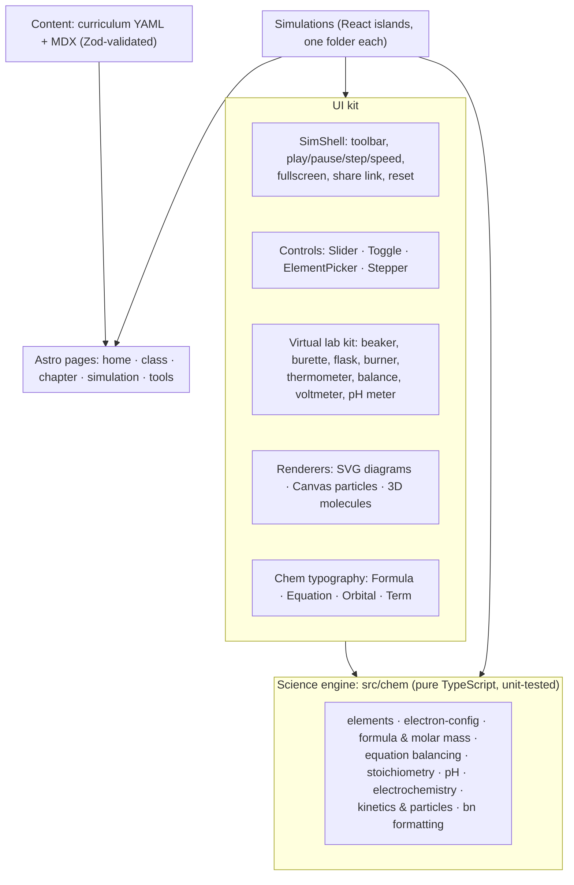

# Chemputer: Architecture Plan

**Goal:** turn Chemputer into the place where Bangladeshi students *see* chemistry. Every topic of the
NCTB Class 9–10 chemistry book gets a simulation, animation or virtual experiment, and the same
structure later absorbs Class 11–12 (HSC 1st & 2nd paper) without a redesign.

Source analysed: NCTB *রসায়ন, নবম–দশম শ্রেণি* (2024 revised edition, 12 chapters, 310 pages).
Each chapter's "এ অধ্যায় পাঠ শেষে আমরা" learning outcomes drive the simulation catalogue in §4.

---

## 1. Principles

1. **Visual first, text second.** Every page opens with something to play with. Text explains what the student just saw.
2. **One source of truth.** Element data, electron configuration, formula parsing and similar logic live in one tested engine. No tool hard-codes its own copy (that is how the old Cr/Cu bug happened).
3. **Adding a simulation is a folder, not a project.** One component + one content file. Navigation, chapter pages, search, sitemap and links update themselves.
4. **Curriculum is data.** Book editions change, so simulations map to *topics* and a curriculum file maps topics to chapters and page numbers.
5. **Fast on a ৳10,000 phone on mobile data.** Static HTML, JavaScript only where there is interaction, offline after the first visit.
6. **Bangla-native.** Bangla UI and digits, proper chemical typography (H₂SO₄, 3d⁵, ⇌), English terms alongside Bangla where students need both.
7. **Scope.** Simulations, animations, virtual labs and step-by-step solvers. No MCQ banks or note dumps (these were removed on purpose).

---

## 2. Technology

| Concern | Choice | Why |
|---|---|---|
| Site framework | **Astro** (static output) | Built for content sites with interactive "islands": pages ship as plain HTML and only the simulation hydrates. File-based routing, typed content collections, MDX, sitemap, image optimisation. Industry standard for docs and learning sites. |
| Interactive parts | **React + TypeScript** | The existing tools are React already and port directly. TypeScript catches data mistakes before students do. |
| Styling | **Tailwind CSS v4** + CSS-variable design tokens | Same utility workflow as now. Tokens make light/dark themes and the chemistry colour language one file. |
| 2D graphics | SVG (diagrams) + Canvas 2D (particles) | SVG for atoms, bonds and glassware; Canvas for hundreds of moving particles at 60 fps. |
| 3D molecules | **three.js via react-three-fiber**, lazy-loaded | Only pages with 3D models download it (≈150 KB), and only when the student taps "3D". |
| Animation | **Motion** (Framer Motion) + one shared simulation clock | Smooth UI transitions, plus a requestAnimationFrame loop with play/pause/speed/step that pauses when off-screen. |
| Charts | Small SVG chart components (or uPlot for live graphs) | Heating curves, pH curves, rate-vs-time. No heavy chart library. |
| Search | **Pagefind** | Static search index built at deploy time. Works with Bangla, no server. |
| Tests | **Vitest** (engine), **Playwright** (each sim loads and responds), **axe** (accessibility) | Chemistry correctness is the product. Every engine function has tests. |
| Hosting | **Vercel** as the primary host | Already connected: preview URL per pull request, redirects, headers, analytics. GitHub Pages becomes a redirect to Vercel. |
| Analytics | Vercel Web Analytics (cookie-free) | Which simulations students actually use, with no personal data (most users are minors). |

**Why not stay as-is?** The current custom build (esbuild + generated HTML) is fine for 5 tools. At 50+ simulations
it lacks routing, content validation, search and per-page SEO, and committing build output gets noisy. Astro gives all of
that while keeping the same React components.

**Why not Next.js?** It ships React to every page, including pure text pages, and adds a server runtime this site does not
need. If accounts or synced progress are ever needed, Astro can add server endpoints on Vercel.

---

## 3. Information architecture

### URL structure

English slugs (they stay readable when shared on Facebook/WhatsApp), Bangla titles on the page.

| URL | Page |
|---|---|
| `/` | Home: choose class, continue where you left off, newest simulations |
| `/ssc/` | Class 9–10: the 12 chapters as cards with progress |
| `/ssc/03-structure-of-matter/` | Chapter hub: what you will learn, topics in book order, every simulation for the chapter |
| `/ssc/03-structure-of-matter/electron-configuration-shortcut/` | One simulation page |
| `/hsc/1st-paper/…`, `/hsc/2nd-paper/…` | Same pattern, added later |
| `/sims/` | Every simulation, filterable by class, chapter and type |
| `/periodic-table/` | Full interactive periodic table, a site-wide reference |
| `/tools/` | Molar mass calculator, equation balancer, unit converter |
| `/glossary/` | পরিভাষা: Bangla ↔ English terms |

Old URLs (`electron_configue_calculator.html` and others) get **301 redirects** in `vercel.json`, so shared links never break.

### Content model



- **Curriculum files** (`src/content/curriculum/ssc.yaml`): chapters, topics, book page ranges and outcomes. When NCTB revises the book, only this file changes.
- **Simulation entries** (`src/content/sims/<slug>.mdx`): frontmatter (title, type, topics, difficulty, status, sources, reviewer) plus the explanation text around the simulation.
- Both are validated with Zod at build time. A simulation pointing at a missing topic fails the build instead of shipping a broken link.

Simulation `type` values: `animation` (guided, step by step) · `simulation` (free exploration with controls) · `lab` (virtual experiment) · `solver` (step-by-step calculation) · `reference` (explorable data).

---

## 4. Simulation catalogue: Class 9–10 (NCTB)

★★★ = build first (core concept, heavy exam weight, hard to grasp from text) · ✅ = exists today.

### অধ্যায় ১ · রসায়নের ধারণা (book p. 1)
| Simulation | Type | Priority |
|---|---|---|
| ল্যাবরেটরি নিরাপত্তা: hazard symbols explorer, what each means and how to handle it | reference | ★ |
| বৈজ্ঞানিক অনুসন্ধান: a virtual investigation (hypothesis → change one variable → observe → conclude), e.g. temperature vs dissolving | lab | ★★ |

### অধ্যায় ২ · পদার্থের অবস্থা (p. 17)
| Simulation | Type | Priority |
|---|---|---|
| কণার গতিতত্ত্ব: particle box, solid/liquid/gas, temperature slider | simulation | ★★★ |
| ব্যাপন ও নিঃসরণ: NH₃ and HCl diffusing in a tube, where the white ring forms, and the effect of temperature and molar mass | simulation | ★★★ |
| গলন, স্ফুটন ও তাপমাত্রা: heating curve of ice → water → steam, with a live thermometer and particles | lab | ★★★ |
| ঊর্ধ্বপাতন: subliming camphor / ammonium chloride | animation | ★★ |
| থার্মোমিটার পড়া: reading practice with a virtual thermometer | lab | ★ |

### অধ্যায় ৩ · পদার্থের গঠন (p. 35)
| Simulation | Type | Priority |
|---|---|---|
| পরমাণু তৈরি করো: add protons, neutrons and electrons, then see element, mass number, charge, ion or isotope | simulation | ★★★ |
| রাদারফোর্ডের আলফা কণা বিক্ষেপণ: gold-foil experiment | animation | ★★★ |
| রাদারফোর্ড বনাম বোর মডেল: why the Rutherford atom would collapse, and Bohr's energy levels with photon emission | animation | ★★★ |
| আইসোটোপ ও আপেক্ষিক পারমাণবিক ভর: abundance sliders → weighted average (Cl = 35.5) | simulation | ★★ |
| প্রতীক এসেছে কোথা থেকে: Latin/English names → symbols (Na ← Natrium, Fe ← Ferrum) | reference | ★ |
| ইলেকট্রন বিন্যাস: শর্টকাট ও আউফবাউ ✅ (move here from Chapter 4) | animation | ✅ |
| শক্তিস্তর ও উপস্তরে ইলেকট্রন: Bohr shells (2, 8, 8, 2) next to orbital boxes | animation | ★★ |

### অধ্যায় ৪ · পর্যায় সারণি (p. 59)
| Simulation | Type | Priority |
|---|---|---|
| ইলেকট্রন বিন্যাস থেকে পর্যায় ও গ্রুপ ✅ | solver | ✅ |
| ব্লক অনুযায়ী গ্রুপ নির্ণয় ✅ | solver | ✅ |
| পর্যায়বৃত্ত ধর্ম ✅ → extend to all 118 elements as `/periodic-table/` | reference | ★★★ |
| ছন্দে ছন্দে পর্যায় সারণি ✅ | reference | ✅ |
| পর্যায় সারণির বিকাশ: timeline (Döbereiner → Newlands → Mendeleev → Moseley), Mendeleev's gaps predicting Ge | animation | ★★ |
| একই গ্রুপ, একই ধর্ম: Li, Na and K in water, with reactivity rising down the group | lab | ★★ |
| বিশেষ নাম: alkali metals, alkaline-earth metals, halogens, noble gases, transition metals on the table | reference | ★ |

### অধ্যায় ৫ · রাসায়নিক বন্ধন (p. 82)
| Simulation | Type | Priority |
|---|---|---|
| যৌগের সংকেত লেখা: valency criss-cross with ions and radicals (Al³⁺ + SO₄²⁻ → Al₂(SO₄)₃) | solver | ★★★ |
| আয়নিক বন্ধন: electron transfer Na → Cl, then MgO and CaCl₂; drag the electrons | animation | ★★★ |
| সমযোজী বন্ধন: dot-and-cross builder for H₂, O₂, N₂, H₂O, NH₃, CH₄ (single, double, triple bonds) | simulation | ★★★ |
| অষ্টক ও দুই নিয়ম: why noble gases are stable | animation | ★★ |
| ধাতব বন্ধন: electron sea; apply a voltage and watch electrons drift | animation | ★★ |
| আয়নিক বনাম সমযোজী: virtual conductivity test (bulb glows for NaCl solution, not for sugar), melting point and solubility | lab | ★★ |

### অধ্যায় ৬ · মোলের ধারণা ও রাসায়নিক গণনা (p. 109)
| Simulation | Type | Priority |
|---|---|---|
| সমীকরণের সমতা বিধান: equation balancer with live atom counts on a balance | solver | ★★★ |
| মোল: mass ↔ moles ↔ particles, "counting by weighing" | simulation | ★★★ |
| শতকরা সংযুতি → স্থূল ও আণবিক সংকেত: step-by-step solver | solver | ★★★ |
| দ্রবণ তৈরি: weigh solute, dissolve, fill a volumetric flask to the mark; molarity | lab | ★★ |
| ভরভিত্তিক হিসাব: stoichiometry and limiting reactant, visualised as particles | solver | ★★ |
| তুঁতের কেলাস পানি: heat CuSO₄·5H₂O (blue → white), then mass change → % water | lab | ★★ |

### অধ্যায় ৭ · রাসায়নিক বিক্রিয়া (p. 142)
| Simulation | Type | Priority |
|---|---|---|
| বিক্রিয়ার হার: collision-theory particles with temperature, concentration, surface area, catalyst and a live rate graph | simulation | ★★★ |
| জারণ-বিজারণ: electron transfer, plus an oxidation-number calculator | animation | ★★★ |
| লা-শাতেলিয়ার নীতি: equilibrium that shifts with temperature, pressure and concentration | simulation | ★★★ |
| বিক্রিয়ার প্রকারভেদ: sort animated reactions (synthesis, decomposition, displacement, redox, reversible, exothermic/endothermic) | reference | ★★ |
| ভৌত বনাম রাসায়নিক পরিবর্তন | reference | ★ |
| লোহার মরিচা: tubes with air, water, oil, salt water and a drying agent over "days"; ways to prevent rust | lab | ★★ |
| অধঃক্ষেপণ ও প্রশমন: mix solutions and watch precipitates form (AgNO₃ + NaCl) | lab | ★★ |

### অধ্যায় ৮ · রসায়ন ও শক্তি (p. 168)
| Simulation | Type | Priority |
|---|---|---|
| তড়িৎ বিশ্লেষণ: molten NaCl, brine, acidified water, CuSO₄ (electroplating); ions migrate to electrodes | simulation | ★★★ |
| গ্যালভানিক কোষ: build a Zn/Cu (Daniell) cell, with electron flow, salt bridge and voltmeter | simulation | ★★★ |
| তাপোৎপাদী ও তাপহারী: energy profile diagram plus virtual thermometer experiments (NaOH dissolving, NH₄Cl dissolving) | lab | ★★★ |
| তড়িৎ বিশ্লেষ্য কোষ বনাম গ্যালভানিক কোষ: side-by-side comparison | animation | ★★ |
| পারমাণবিক বিদ্যুৎ: fission chain reaction, controlled vs uncontrolled (Rooppur context) | animation | ★★ |
| জ্বালানি ও দহন: complete vs incomplete combustion, fuel comparison | simulation | ★ |

### অধ্যায় ৯ · এসিড-ক্ষারক সমতা (p. 206)
| Simulation | Type | Priority |
|---|---|---|
| pH স্কেল ও নির্দেশক: household substances on the pH scale; litmus, phenolphthalein, methyl orange and universal indicator colours | reference | ★★★ |
| প্রশমন / টাইট্রেশন: burette adds NaOH to HCl, with a pH curve and indicator change | lab | ★★★ |
| খর পানি: soap lather vs scum; temporary vs permanent hardness and how to remove each | lab | ★★ |
| এসিড বৃষ্টি: how SO₂ and NO₂ form acids, and the effect on marble and plants | animation | ★★ |
| পানি পরিশোধন: coagulation → sedimentation → filtration → chlorination; arsenic awareness | animation | ★★ |
| পানিচক্র | animation | ★ |

### অধ্যায় ১০ · খনিজ সম্পদ: ধাতু-অধাতু (p. 233)
| Simulation | Type | Priority |
|---|---|---|
| সক্রিয়তা সিরিজ → নিষ্কাশন পদ্ধতি: choose the extraction method for a metal | solver | ★★★ |
| মারুত চুল্লি: iron extraction in a blast furnace | animation | ★★ |
| সংকর ধাতু: why alloys are harder (atomic layers that cannot slide) | animation | ★★ |
| স্পর্শ পদ্ধতি: sulfur → SO₂ → SO₃ → H₂SO₄ with conditions | animation | ★★ |
| শিলা, খনিজ ও আকরিক: sorting explorer | reference | ★ |

### অধ্যায় ১১ · খনিজ সম্পদ: জীবাশ্ম (p. 261)
| Simulation | Type | Priority |
|---|---|---|
| পেট্রোলিয়ামের আংশিক পাতন: fractionating column with temperature and fractions | animation | ★★★ |
| হাইড্রোকার্বন বিল্ডার: build alkanes, alkenes and alkynes in 3D, with names and isomers | simulation | ★★★ |
| জৈব রূপান্তর মানচিত্র: hydrocarbon → alcohol → aldehyde → acid, each arrow with its reagent and condition | reference | ★★★ |
| সম্পৃক্ত বনাম অসম্পৃক্ত: bromine-water test | lab | ★★ |
| পলিমারকরণ: ethene → polythene chain growing | animation | ★★ |
| জৈব বনাম অজৈব যৌগ: heating test | lab | ★ |

### অধ্যায় ১২ · আমাদের জীবনে রসায়ন (p. 287)
| Simulation | Type | Priority |
|---|---|---|
| সাবান: saponification, and how soap micelles lift grease | animation | ★★ |
| বেকিং পাউডার: NaHCO₃ + acid → CO₂ and the dough rises | lab | ★★ |
| ব্লিচিং পাউডার: bleaching action | lab | ★ |
| মাটির pH নিয়ন্ত্রণ: lime for acidic soil (reuses the pH scale) | simulation | ★ |
| খাদ্য সংরক্ষণ: methods and why they work | reference | ★ |

**Total:** 68 simulations for Class 9–10: 5 already exist (one of them to be extended), 25 are ★★★, 27 ★★ and 12 ★.

---

## 5. Shared building blocks

Everything a simulation needs comes from three shared layers, so each new simulation is mostly *content*.



- **Science engine (`src/chem/`):** one data set for all 118 elements (vetted source plus curated Bangla names), and pure functions with tests. Example: `parseFormula("CuSO4·5H2O")`, `balance("Fe + O2 -> Fe2O3")`, `phFromConcentration()`.
- **SimShell:** every simulation has the same controls in the same place. Students learn the interface once.
- **Virtual lab kit:** the book has many "পরীক্ষার মাধ্যমে দেখাতে পারব" outcomes. One set of SVG glassware and instruments with shared behaviour (liquid level, colour mixing, bubbles, precipitate, heat) lets you build each experiment quickly.
- **Step player (`useSteps`):** the play/pause/←→ stepper from the current shortcut tool, generalised for any "ধাপে ধাপে" animation.
- **Chemical typography:** `<Formula>H2SO4</Formula>` renders H₂SO₄, `<Equation>` handles arrows and states, and `<Term>` shows the English term on tap.

---

## 6. Simulation page template

Every simulation page follows the same order:

1. **Header:** chapter, title, "বই: পৃষ্ঠা ৫৯–৬২", type badge
2. **The simulation**, above the fold on phones, with a fullscreen button
3. **কী দেখলে?:** a short explanation tied to what is on screen
4. **নিজে চেষ্টা করো:** 2–3 exploration challenges inside the simulation (e.g. "Cl-এর পারমাণবিক ভর ৩৫.৫ বানাও"). Not a quiz.
5. **পরীক্ষায় যেভাবে আসে:** how board questions use this concept
6. **সাধারণ ভুল:** misconceptions
7. **Related simulations** and previous/next in book order

---

## 7. UI and theme

- **Themes:** keep the current dark violet brand and add a **light theme** (phones in daylight, classroom projectors). Follow the system setting, with a toggle.
- **Design tokens:** surfaces, text and accent as CSS variables. A **chemistry colour language** is defined once and used everywhere:
  - s/p/d/f blocks: already done
  - element categories
  - acid ↔ base (pH colours)
  - oxidation (red) ↔ reduction (blue)
  - solid/liquid/gas particles
  - exceptions in rose
- **Navigation:**
  - class switcher (৯–১০ / ১১–১২)
  - chapter sidebar on desktop, bottom sheet on mobile
  - breadcrumbs and previous/next
  - Ctrl+K search
- **Mobile first:** 360 px baseline, 44 px touch targets, landscape fullscreen for simulations.
- **Presentation mode (`?present=1`):** large text with no site chrome, for live classes and YouTube recordings. **Embed mode (`?embed=1`)** to place a simulation inside slides or other sites.
- **Progress without accounts:** "দেখা হয়েছে" ticks, bookmarks and "continue where you left off", stored on the device.
- **Offline (PWA):** visited chapters keep working without data; installable to the home screen.
- **Accessibility:** WCAG 2.2 AA, full keyboard use, reduced-motion support, and screen-reader descriptions of what the simulation is showing.
- **Language:** all UI strings in one Bangla file, so an **English-version** site (NCTB publishes English-version books) can be added later at `/en/…`.

---

## 8. Performance budgets

| Page type | JavaScript (gzipped) | Target |
|---|---|---|
| Text pages (home, chapter, glossary) | ≈ 0 KB | Instant |
| 2D simulation | ≤ 100 KB, React shared and cached | LCP < 2.5 s on a mid-range Android over 4G |
| 3D simulation | 3D library loaded only on demand | Interactive < 4 s |

Other rules:
- Animations pause when off-screen or when the tab is hidden.
- Canvas resolution adapts to device pixel ratio.
- Fonts are self-hosted and subset (already done).

---

## 9. Engineering standards

- **Repository:** single package (no monorepo needed), TypeScript strict, ESLint + Prettier.
- **Tests:**
  - Vitest for every engine function, with golden answers taken from the textbook.
  - Playwright smoke test per simulation (loads, controls respond, no console errors).
  - axe accessibility scan.
- **CI (GitHub Actions on every pull request):** typecheck → lint → test → build → Lighthouse budget check. Vercel posts a preview URL.
- **Branching:** feature branches with pull requests; `main` is always deployable. Vercel builds from source, so build output is no longer committed.
- **Chemistry review:** each simulation's frontmatter lists `sources` and `reviewedBy`. A "ভুল পেয়েছ? জানাও" link on every page opens a GitHub issue form.
- **Copyright:** reference NCTB page numbers and follow the syllabus, but write original explanations; do not copy book text or figures. Simulations, diagrams and wording are Chemputer's own.

### Adding a simulation (the whole workflow)

```bash
npm run new:sim -- --level ssc --chapter 7 --slug reaction-rate
```

1. The script creates `src/sims/reaction-rate/Sim.tsx` (SimShell stub) and `src/content/sims/reaction-rate.mdx` (frontmatter filled in).
2. Build the interaction with the UI kit and engine. Add engine tests if new chemistry logic is needed.
3. Write the explanation sections in the MDX file.
4. Open a pull request, then check the Vercel preview on a phone.
5. Merge. The simulation appears on the chapter hub, in `/sims/`, in search, in the sitemap and on the home page "নতুন" list.

---

## 10. Roadmap

| Phase | Scope | Done when |
|---|---|---|
| **0. Foundation** | Move to Astro + TypeScript; curriculum and content collections; SimShell, step player, typography, tokens with light/dark themes; port the 5 existing tools (shortcut → Chapter 3, others → Chapter 4); redirects for old URLs; CI and tests | Same 5 tools live at new URLs; old links redirect; adding a simulation takes one folder |
| **1. Atom & table** | Chapters 3–4: build-an-atom, Rutherford, Bohr, isotopes, full 118-element periodic table | Chapters 3–4 complete |
| **2. Bonding & calculation** | Chapters 5–6: formula writing, ionic/covalent/metallic bonding, equation balancer, mole, empirical formula | Highest exam-weight chapters covered |
| **3. Reactions & energy** | Chapters 7–8: reaction rate, redox, equilibrium, electrolysis, galvanic cell, energy profiles. Virtual lab kit matures here | All ★★★ items through Chapter 8 |
| **4. Matter & everyday chemistry** | Chapters 2, 9–12 and 1: particles, diffusion, heating curve, pH and titration, extraction, fractional distillation, hydrocarbons, soap | Class 9–10 complete |
| **5. HSC** | HSC 1st & 2nd paper: quantum numbers and 3D orbitals, line spectra and flame tests, gas laws, equilibrium constants, buffers, thermochemistry, Nernst, organic mechanisms, chromatography. Same engine and kit | `/hsc/` live |

Inside each phase, ship ★★★ items first and release each simulation as soon as it is ready. The site grows a little every week instead of in big jumps.

---

## 11. What changes in the current site

| Today | After Phase 0 |
|---|---|
| Every tool labelled "অধ্যায় ৪" | Shortcut and configuration move to **Chapter 3** (পদার্থের গঠন); the book teaches electron configuration there |
| Custom `build.mjs`, generated HTML committed | Astro build on Vercel; source only in git |
| Flat `*.html` URLs | `/ssc/<chapter>/<sim>/` with 301 redirects from the old URLs |
| Dark theme only | Dark and light themes from the same tokens |
| `src/lib/chem.js` | Becomes `src/chem/` (TypeScript, with tests), the start of the engine |
| `src/ui/*` | Becomes the UI kit (SimShell, controls, typography) |
